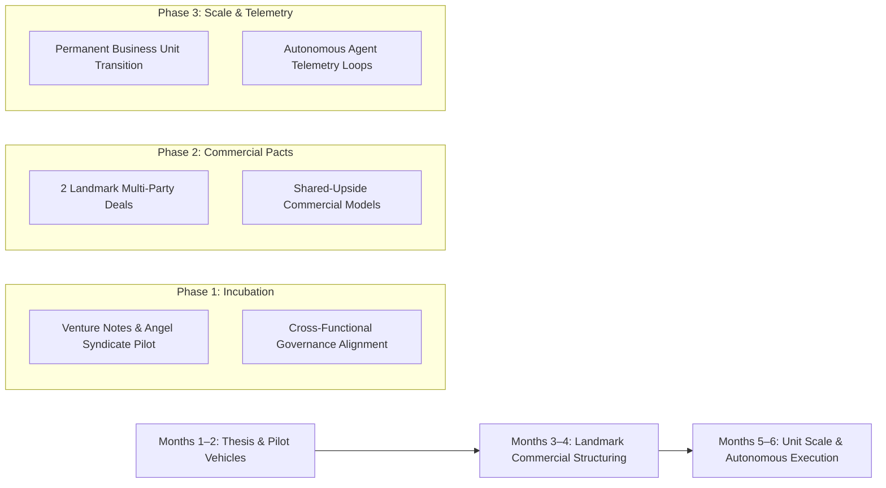

# 🧭 OpenAI Special Situations Strategy Brief: Financial Services & Commercial Deal Architecture

**Role:** Deal Lead, Special Situations  
**Author:** Pavel Cherkashin (`pavel@mindrock.capital`)  
**Context:** OpenAI Special Situations Commercial Engine  
**Linear Issue:** `MIN-210`  

---

## 1. Executive Summary & Special Situations Mandate

OpenAI's Special Situations team represents the tip of the spear for commercial innovation: transforming unprecedented technical capabilities into entirely new businesses, non-standard commercial models, and multi-billion-dollar market opportunities.

Where standard enterprise sales teams sell defined SaaS SKUs (ChatGPT Enterprise, API token access) through predictable procurement channels, the **Special Situations Deal Lead** operates in environments of extreme ambiguity:
1. **Uncharted Commercial Territory:** Opportunities where no product packaging, pricing schedule, or standard contract exists.
2. **0-to-1 Business Incubation:** Taking a high-conviction thesis from blank-page concept through partner co-development, prototype delivery, commercial validation, and institutional scaling.
3. **Complex Value Structuring:** Architecting multi-party alignments that balance compute access, proprietary data rights, revenue-sharing, and equity/warrant participation.

---

## 2. Vertical Strategy: Financial Services First

Financial Services is the most capital-dense, data-rich, and cognitively leveraged industry in the global economy. It is also the natural proving ground for OpenAI Special Situations.

### Why Financial Services First?
* **High Economic Sensitivity:** A 100-basis-point improvement in deal sourcing, due diligence velocity, or risk underwriting translates to hundreds of millions in net alpha.
* **Complex Multi-Party Ecosystems:** Venture capital, private equity, investment banks, and institutional LPs rely on intricate legal instruments (convertible notes, SAFEs, LP agreements, SPVs) that are ripe for programmatic transformation.
* **Willingness to Pay for Asymmetric Advantage:** Institutional capital allocators do not buy commodity software; they invest in structured partnerships that grant strategic compute access and proprietary cognitive tooling.

### Priority Financial Services Sub-Verticals
1. **Venture Capital & Early-Stage Syndication:**
   * **Venture Notes & Programmatic SPVs:** Packaging OpenAI cognitive agents directly into deal structuring and investor distribution channels.
   * **Fintech Angels & Syndicate Automation:** Enabling distributed angel networks to conduct institutional-grade synthetic due diligence in minutes.
2. **Private Equity & Corporate Special Situations:**
   * Autonomous carve-out analysis, operational telemetry ingestion, and cross-portfolio synergy modeling.
3. **Investment Banking & M&A Underwriting:**
   * Automated fairness opinions, dynamic financial modeling, and real-time regulatory compliance mapping across multiple legal jurisdictions.

---

## 3. The 6-Month Commercial Acceleration Arc

### Phase 1: Thesis Formulation & Pilot Vehicles (Months 1–2)
* **Flagship Financial Services Thesis:** Publish the definitive thesis on AI-native deal execution, underwriting, and structured finance vehicles.
* **Pilot Deal Structures:** Formulate initial pilot agreements with 3 top-tier venture firms and fintech syndicates using standardized "AI Venture Notes".
* **Cross-Functional Guardrails:** Coordinate with OpenAI Research, Product, Legal, Finance, and Forward Deployed Engineering (FDE) to establish boundaries for customer data isolation, model fine-tuning IP, and regulatory SEC/FINRA compliance.

### Phase 2: Landmark Commercial Structuring (Months 3–4)
* **Originating Landmark Pacts:** Close 2 non-standard, flagship partnerships with major financial institutions (e.g., Tier-1 asset manager or global investment bank).
* **Creative Economic Architectures:** Implement hybrid compensation models:
  * Minimum compute commitments + revenue sharing on syndicated capital.
  * Shared IP and distribution rights for specialized financial reasoning fine-tunes.
  * Structural warrants or performance-based upside alignment.
* **Execution Blueprint:** Document standard operating procedures for rapid legal, technical, and commercial negotiation of future special situations.

### Phase 3: Business Unit Scale & Autonomous Execution (Months 5–6)
* **Permanent Business Line:** Graduate the financial services incubation effort into a recurring, high-margin commercial vertical with dedicated quota and headcount.
* **Autonomous Intelligence Engine:** Deploy continuous AI agent monitoring across global deal flow, LP allocations, and regulatory updates to feed the business unit's pipeline.
* **Vertical Expansion:** Adapt the Special Situations deal playbook to adjacent high-capital verticals:
  * Energy & Compute Infrastructure (hyperscaler joint ventures, green power pacts).
  * Sovereign AI Initiatives (national wealth fund partnerships, localized infrastructure).

---

## 4. Cross-Functional Execution & Stakeholder Alignment

A Deal Lead in Special Situations must lead without formal authority, unifying diverse internal and external stakeholders:

1. **Research & Core Engineering:** Ensuring customer use cases push the boundaries of frontier model capabilities while respecting safety and alignment guardrails.
2. **Forward Deployed Engineering (FDE):** Designing technical prototypes and customized customer integrations that prove feasibility before full contractual commitment.
3. **Legal & Regulatory Counsel:** Navigating untested securities law, data sovereignty, and AI copyright boundaries with innovative contract structures.
4. **Finance & Pricing Strategy:** Modeling non-linear pricing, compute capacity constraints, and risk-adjusted customer lifetime value.

---

## 5. Summary of Fit & Candidate Differentiation

* **Proven Mega-Deal Closer:** Negotiated and closed the largest enterprise/institutional transaction in Adobe's history (1.5M+ licenses).
* **Venture Capital & Fintech Veteran:** $100M+ deployed, pioneer of structured venture notes, founder of fintech investment syndicates.
* **AI Systems Practitioner:** Directly builds and deploys multi-agent autonomous networks, ensuring technical credibility with OpenAI's engineering and research teams.
